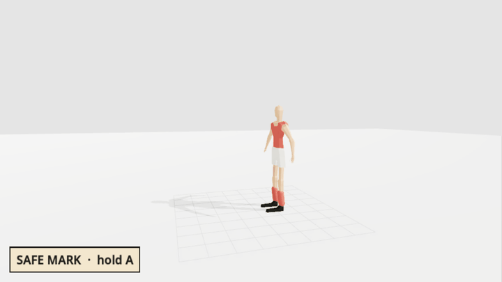
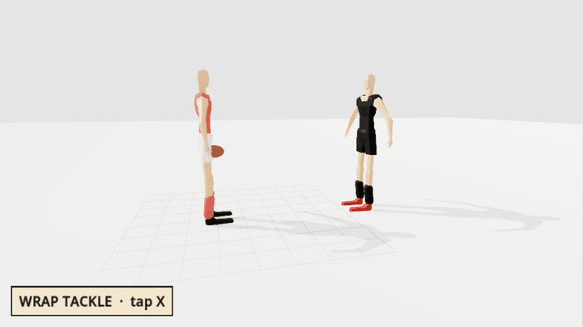
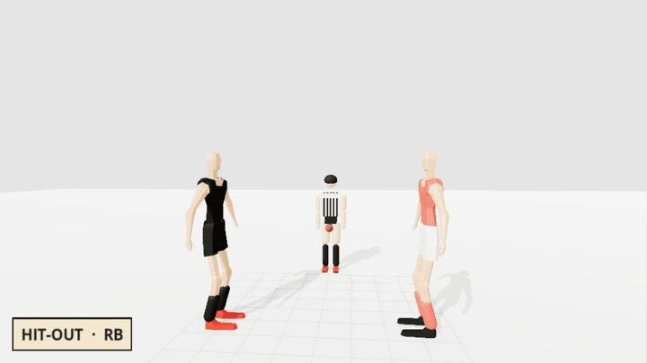
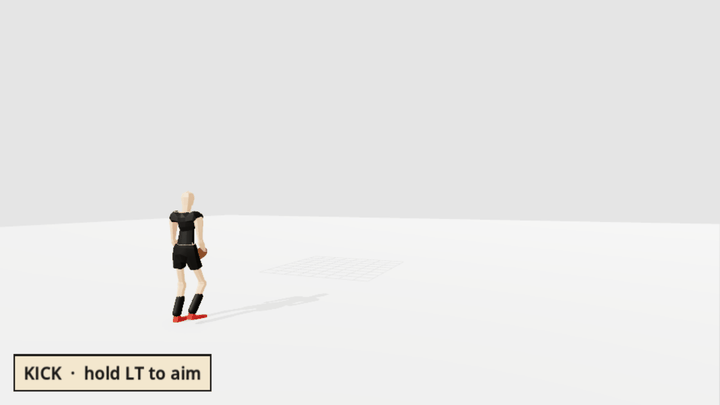
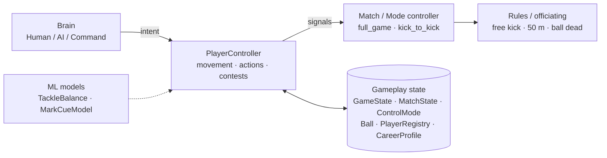
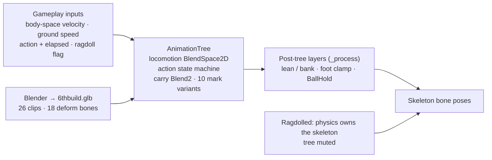

# Aussie Rules 2

A realistic 3D Aussie Rules football game built in **Godot 4.6** with Jolt
physics.

Contests are physically simulated. Kicking, marking, tackling, spoiling,
smothering and ruck contests come from player movement, timing, positioning
and physics, never from a dice roll.

**Status:** a full 18-a-side match. AI runs every player you're not
controlling. There's a real clock and quarters, and goal/behind restarts.
Kicking, handballing, bouncing, marking, tackling, spoiling, smothering,
bumping and ruck contests are all physically resolved. Umpiring covers
holding the ball, running too far, off-the-ball free kicks and 50 m
penalties. Tackles and bumps hand the players to an **active ragdoll**, and a
tackle that lands holds or breaks on a trained tackle model. There's also a
**Career** mode: create a player and play a season with a ladder, fixture,
roster and stats. A solo **Kick-to-Kick** mode has kicking, marking and
tackling coaches. Players use an imported Blender model with 26 clips, and
the two ovals are generated in Blender. Sound is still synthesized in code.


- [Run](#run)
- [Feature demos](#feature-demos): [marking](#marking), [tackling](#tackling), [ruck](#ruck), [kicking](#kicking)
- [Architecture](#architecture)
- [Architectural principles](#architectural-principles)
- [Controls](#controls)
- [Project layout](#project-layout)
- [Dev tools](#dev-tools)
- [Git branch guide](#git-branch-guide)

The rules as implemented are in
[docs/RULES_REFERENCE.md](docs/RULES_REFERENCE.md). The engineering notes are
in [docs/LESSONS.md](docs/LESSONS.md).


## Run

### Windows: play the game

1. Go to the [latest release](https://github.com/Yaandle/aussie-rules2/releases).
2. Download **`Aussie-Rules-2-v1.2.0-Windows.zip`**.
3. Extract the ZIP and run **`Aussie Rules 2.exe`**.
4. Select **FULL GAME** from the main menu.

No Godot, Python, Git or other setup is needed.

v1.2.0 came out on 2026-10-21. It's older than the full Career season,
the active ragdoll tackles and the Field 1 / Field 2 ovals. To play those,
run from source.

### Development: Godot editor

1. Install **Godot 4.6+**.
2. Clone the repository:

```powershell
git clone https://github.com/Yaandle/aussie-rules2.git
```

3. In Godot, choose **Import**, open the project's `project.godot`, then
   press **Play Project**.

### Development: PowerShell

```powershell
& "C:\Godot\Godot_v4.6-stable_win64_console.exe" --path "F:\dev\aussie-rules2"
```

Use your own Godot path and project path. No build step is needed.


## Feature demos

Each demo was recorded in the [animation viewer](#dev-tools)'s studio by
`scenes/dev/demo_recorder.tscn`. It runs the real gameplay code on real
players, not canned poses. The recorder only presses the buttons and moves
the camera.

### Marking



There are three ways to take a mark. Each trades reach against commitment.

| Mark | Keyboard | Pad | What it does |
|---|---|---|---|
| **Safe** | `G` (hold) | A (hold) | Plants you and takes it on the chest. Widest reach. |
| **Running** | `Q` (tap) | X (tap) | Takes it in stride without breaking your run. Tighter reach. |
| **Aggressive** | `H` (tap) | Y (tap) | Commits you to a leap the instant you press. It catches at the top of the jump, 0.4 s later. |
| Spoil | `P` (tap) | LT (tap) | Punches the ball off its line instead of catching it. |

- **One prompt.** A badge over your player's head shows the mark that fits
  right now, chosen from your speed and where the ball is. Once you press,
  it shows the button you pressed.
- **Timing ring.** A ring closes in on the badge. It lands at the moment to
  press, timed from the ball's real flight. That's the same number the catch
  is graded on (`PlayerController.mark_timing_offset`). With the current
  `GATED` cue, the Aggressive ring won't finish until the leap can reach the
  ball.
- **Timing sets reach.** A press inside the ideal window gets full reach. A
  press in the contested window gets less, and a press outside it gets none.
  The catch then checks the ball's real position against that reach. The
  ball collides with bodies, so a leap at the wrong moment can knock it away.
- **Legal mark.** A kick that has travelled 15 m and is caught is a mark.
  You're protected, and you walk back 7.5 m off the mark before a set shot.

### Tackling



| Tackle | Keyboard | Pad | What it does |
|---|---|---|---|
| **Wrap (Lunge)** | `Q` (tap) | X (tap) | Dashes at a carrier within 2.2 m. If it holds, the carrier ragdolls and the tackler wraps their arms round the waist. Both go down together. |
| **Sling (Slide)** | `E` (hold) | B (hold) | Steps in, or dives at a carrier just out of reach. A soft hit holds them up with both players standing. A hard hit slings them to the ground while the tackler stays up. |
| **Hit stick (Bump)** | `L` + arrow tap | LB + right-stick flick | Dashes in the flick's direction, with a little homing. A clean hit on a carrier running onto it spills the ball, throws the carrier and sends the bumper diving after them. A whiff puts the bumper on the turf. |

How a tackle is decided:

1. **Did it land?** The tackle must reach the carrier with enough closing
   speed and from a square enough angle. A missed lunge only costs a short
   cooldown. A missed slide stuns you.
2. **Does it hold?** `TackleBalance` reads the contact: closing speed,
   squareness and the two players' mass ratio. From those it computes a
   balance loss `b` using the logistic-regression formula. Its weights were
   trained on the ML page (LR, then GA) and stored in
   `data/ml/tackle_weights.json`. The carrier's share is `p(break) = 1 − b`.
   The tackle breaks if that's past a fixed threshold (wrap 0.5, sling
   0.95). It's evaluated, never rolled: the same hit gives the same result
   every time.
3. **How do they fall?** The same `b` sets how hard the ragdoll's muscles
   fight to stay up (`1 − b`). The push goes along the hit line. Where the
   body ends up is where the player is.
4. **What's the ruling?** If the carrier had prior opportunity (0.5 s), it's
   holding the ball and a free kick. If not, it's a ball-up. Tackling or
   bumping a player without the ball is a free kick to them. Hitting a player
   protected by a mark or free kick gives away a 50 m penalty.

Only a human's tackle or bump starts a ragdoll. AI tackles still play
animation clips.

### Ruck



| Action | Keyboard | Pad |
|---|---|---|
| Hit-out (ruck contest only) | `J` | RB |
| Aim the tap | arrow keys | right stick |

- **One contest, three restarts.** Centre bounces, field ball-ups and
  boundary throw-ins all go through the same contest.
  `FullGame._begin_ruck_contest` decides where it happens and who contests
  it. `PlayerController` only knows how to contest one.
- **Two ruckmen.** Only the two nominated players may play the ball. The
  players around the contest hold their positions until the tap lands or
  the 2 s window ends.
- **Your timing.** Pressing RB with the ball in range jumps at once. An
  early press, during the umpire's throw-up, is held until the ball slows
  near its peak, so you never leap under a ball that's still rising.
- **A palm, not a catch.** The hit-out knocks the ball toward the right
  stick if you're holding it. Otherwise it goes toward the left stick, and
  failing that, straight ahead. That lets a ruckman tap to a runner.

### Kicking



| Action | Keyboard / mouse | Pad |
|---|---|---|
| Kick stance: hold to aim and charge | Right mouse (or `K`) | LT (hold) |
| Kick: aimed, while in stance | Left mouse (or `F`) | RT |
| Hip-fire: quick and less accurate | Left mouse (or `F`) without stance | RT without LT |
| Line up a set shot after a mark | `X` | Y |
| Handball, toward the move direction | `Q` | X |
| Bounce, at least every 30 m of running | `Space` | B |
| Smother an opponent's kick | `J` | RB |

- **Stance, then strike.** Holding the stance charges the kick and draws
  the predicted flight. Releasing without kicking cancels it. A hip-fire
  kicks at fixed power with up to 20° of scatter.
- **A drop punt.** The ball is dropped, the leg swings straight and the
  foot is pointed. The boot meets the ball about 0.95 m in front of the
  player. The contact moment comes from `Tuning.ACTION_CONTACT`, and the
  clip is lined up to it.
- **The ball does the rest.** A kick is an impulse with end-over-end
  backspin, from 13 m/s for a stab pass to 24 m/s for a full drop punt. The
  ball is a `RigidBody3D` with a prolate-spheroid hull, so bounces are
  erratic. In flight, `v²` air drag gives the lazy-up, steep-down arc, and
  Magnus force lets spin curve the flight.
- **Set shot.** After a mark within 55 m of goal, lining up the shot walks
  the kicker back to pace out a run-up. The kick button then starts a short
  walk-to-jog run-up, and the kick happens at the end of it.


## Architecture

This section started from the project's first sketchbook diagrams of the
technical architecture. It was checked against the code on 2026-10-29. It has
five parts, one for each layer of a frame.

### 1. Game loop (gameplay)



| Part | Where | What it owns |
|---|---|---|
| Match / Mode controller | `scripts/modes/full_game.gd`, `kick_to_kick.gd` | Phases and stoppages, scoring, free kicks, control switching |
| Player Controller | `scripts/player/player_controller.gd` (`CharacterBody3D`) | Movement, actions, contest resolution |
| Brain | `scripts/mechanics/*_brain.gd` | Intent. Human reads input; AI decides and positions; Command is AI plus a move-here order |
| Gameplay state | autoloads, `Ball`, `PlayerRegistry` | Each piece of state has one owner. There's no single global store. |

The AI thinks every physics tick, with human-like reaction delays. Two
trained models feed gameplay. `TackleBalance` (LR/GA weights) decides
whether a tackle holds. `MarkCueModel` times the marking ring.

### 2. Player and ball physics

| Body | Type | What it does |
|---|---|---|
| Player body | Kinematic capsule (`CharacterBody3D`) | Velocity set by movement code; gravity applied by hand; `move_and_slide()` |
| Player ragdoll | `PhysicalBone3D` under Jolt (`PhysicsRagdoll`, `PlayerRagdoll`) | 6DOF joints built at rest pose, anatomical limits (Jolt fails past ~75°), joint motors plus a balance assist at strength `1 − b`, face-up and face-down get-ups. A tackler's wrap is a servo (`TackleWrap`), not a joint. |
| Ball | `RigidBody3D` | Mass, gravity and impulses; prolate-spheroid hull; `v²` drag; Magnus force; locked while held and at stoppages |
| Collision | Jolt | Collision layers (ragdolls on their own layer 5), a temporary collision exception between tackle partners, and contact checks in code for gathers, tackles, bumps and smothers |

A player is a kinematic capsule until a tackle or bump hands them to the
ragdoll. While they fall, the capsule follows the ragdoll's hips, so gameplay
position is wherever the body lands. The get-up hands them back. Ragdolls
are built on a player's first tackle, not up front, and they're parked
between tackles.

### 3. Movement and collision (frame timing)

Every player runs the same five steps in each physics tick. This is an
abridged excerpt of `PlayerController._physics_process`:

```gdscript
func _physics_process(delta: float) -> void:
	_brain.update(self, delta)          # 1. Intent: the brain thinks
	# ...timers tick down...
	if is_ragdolled():
		_ragdoll.step(delta)            #    a ragdoll or wrap steps in the same tick
	_update_charge(delta)               #    action updates: kick charge, marking,
	_update_marking(delta)              #    ruck, bump, tackle hold, dives...
	_update_action(delta)
	_update_locomotion(delta)           # 2. Move: gravity and locomotion
	move_and_slide()
	_try_gather()                       # 3. Contact and contest: resolved
	_try_tackle()                       #    deterministically, no dice
	_try_lunge_tackle()                 # 4. Results: possession, ragdoll hand-off,
	_try_bump_contact()                 #    signals to the rules
	_try_smother_contact()
	_animation.drive(locomotion_blend(), delta, ground_speed)  # 5. Drive animation
```

Every contest is resolved before the next physics step. A tackle runs like
this: the tackle lands, `TackleBalance` gives `b`, `p(break) = 1 − b` is
checked against the threshold, and the result is hold or break. A hold hands
the player to the ragdoll.

### 4. Animation (visual state)



- **Animated mode.** Information flows one way, from physics to animation.
  The blend space is keyed on the body's real velocity in body space, not on
  the stick. When a sprinting player cuts, the body turns before the
  momentum does, and the strafe clips blend in on their own. Stride rate is
  matched to the real ground speed. The tree itself is built in GDScript
  (`player_animation.gd`).
- **Ragdolled mode.** Physics owns the skeleton through `PhysicalBone3D`
  bodies, motors and the wrap IK. The tree is muted until the get-up.
- There's no root motion. Animation maps gameplay state to motion and never
  moves the body.

### 5. Rendering (visual output)

Godot 4.6, Forward+.

| Scene input | Detail |
|---|---|
| Camera | `BroadcastCamera`: third-person chase or full-side broadcast |
| Lights | Sun with shadows, 120 m shadow distance in matches |
| Meshes and materials | Players, turf, fences and umpires. Kit colours are applied by Blender material name. |
| Environment | `broadcast_environment`: sky, ACES tonemapping, glow, fog |
| MultiMesh | `OvalEnvironment` batches ~500 linked tree and prop copies into ~14 MultiMeshes |

The passes run in this order: shadow maps, depth pre-pass, opaque
(materials, lights, shadows), procedural sky, transparent, post (ACES, glow,
fog), UI canvas layers, frame buffer (MSAA 2×). How much visual complexity
this can comfortably support hasn't been measured yet. That's the planned
graphics and performance test.


## Architectural principles

### Separation of concerns: logic, rendering, physics, visuals

The player doesn't know who's driving it. The rules don't live in the player,
and the audio and UI don't reach into either one. `PlayerController` decides a
holding-the-ball ruling and only announces it. The match mode awards the free
kick:

```gdscript
# scripts/player/player_controller.gd: the tackle decides and announces
if holding_the_ball:
	holding_the_ball_called.emit(by)
else:
	field_ball_up_called.emit(by, self)

# scripts/modes/full_game.gd: the match listens and officiates
player.field_ball_up_called.connect(_on_field_ball_up)
player.holding_the_ball_called.connect(_on_holding_the_ball)
player.run_too_far_called.connect(_on_run_too_far)
player.infringed.connect(_on_infringed.bind(player))
```

`AudioManager` hooks the same signals, so gameplay code never knows sound
exists. `MarkPrompt` draws `mark_timing_offset()` and never works out
eligibility on its own.

### Data driven: telemetry, configs, assets

- **Config:** every tunable number is in `scripts/tuning.gd`, including
  action timing tables that gameplay reads by index. Guesses that haven't
  been playtested are marked as such.
- **Trained data:** the tackle model's weights are a JSON file the ML page
  writes and the game reads.
- **Telemetry:** the mark-cue harness records every attempt to
  `data/ml/mark_cue/*.csv` (464 attempts trained the MLP cue).
- **Assets:** imported models are recoloured by material name (`Shirt`,
  `Short`, `Sock`, `Boot`, `Skin`). Settings, the character and the Career
  save persist to `user://*.cfg`.

```gdscript
# scripts/mechanics/tackle_balance.gd
const WEIGHTS_PATH := "res://data/ml/tackle_weights.json"

static func reload() -> void:
	_weights = DEFAULT_WEIGHTS.duplicate()
	if not FileAccess.file_exists(WEIGHTS_PATH):
		return
	var parsed = JSON.parse_string(FileAccess.get_file_as_string(WEIGHTS_PATH))
	...
```

```json
{ "w_speed": 4.49, "w_angle": 3.37, "w_stamina": 3.36, "bias": -5.6,
  "source": "GA tab, default params (seed 1), retrained 2026-10-25 with weight ratio as the third input" }
```

### Modular and extensible: features, mechanics, AI

Every decision a player makes goes through one `PlayerBrain` interface. A
human, the AI and a team-command order all plug into the same
`PlayerController`. Adding a new controller type means writing a new brain,
not changing the player:

```gdscript
# scripts/mechanics/human_brain.gd
class_name HumanBrain extends PlayerBrain
func wants_tackle() -> bool:
	return Input.is_action_pressed(&"tackle")

# scripts/mechanics/ai_brain.gd
class_name AIBrain extends PlayerBrain
func wants_tackle() -> bool:
	return _tackle_wanted          # cached by this tick's think in update()

# scripts/mechanics/command_brain.gd
class_name CommandBrain extends AIBrain   # AI, plus a move-here order on top
```

Mechanics are built the same way. One ruck contest serves three restarts.
Kick, handball and bounce all launch through `_launch_from`. The coaches
share a `CoachChallenge` base.

### Physics is authoritative for gameplay

An outcome comes from the bodies, the ball and timing. The ML model is
evaluated on the real contact, not rolled. This is a lunge landing, from
`player_controller.gd`:

```gdscript
var impact := TackleBalance.resolve(global_position, hit_velocity, body_mass,
	target.global_position, target.velocity, target.body_mass, ...)
last_tackle = impact.merged({"slide": false,
	"held": float(impact.p_break) < Tuning.TACKLE_LUNGE_BREAK_P})
if not last_tackle.held:
	target._break_tackle()
	return
_lunge_connect(target, impact, true)   # ragdoll at strength 1 - b
```

Marking works the same way. Timing narrows your reach, and the ball's real
position decides the catch (`_timing_reach_mult`, `_ball_in_catch_reach`).
The ball's flight is forces inside Jolt's own integration step:

```gdscript
# scripts/ball/ball.gd
func _integrate_forces(state: PhysicsDirectBodyState3D) -> void:
	var v := state.linear_velocity
	state.apply_central_force(-v * v.length() * Tuning.BALL_DRAG_COEFF)              # v² drag
	state.apply_central_force(state.angular_velocity.cross(v) * Tuning.BALL_MAGNUS_COEFF)  # Magnus
```

(Simplified. The real function skips near-zero speed and spin, and adds the
catch assist.)

### Maintainable and scalable: clean code, docs

- Each script starts with a `##` header that explains why the code is the
  way it is. Durable lessons go in `docs/LESSONS.md`. Audits and plans are in
  `docs/*_AUDIT.md`.
- Feel numbers say whether they've been playtested:

  ```gdscript
  const TACKLE_LUNGE_BREAK_P := 0.5               # unplaytested feel guess
  const TACKLE_SLIDE_BREAK_P := 0.95              # unplaytested feel guess
  ```

- Changes are verified headless. `scenes/dev/tackle_sweep.tscn` runs real
  wrap, sling and bump connects and prints how every body fell. Its header
  holds the baseline.
- Costs scale with what's happening, not with team size. Ragdolls are built
  on a player's first tackle ("never all 36 up front") and parked between
  tackles. Only players in the contact are simulated. Field props are
  batched into MultiMeshes.

### Rendering and animation are decoupled

Gameplay runs on its own clock, and animation follows it. Each action's
contact moment is a number in `Tuning`, not an event in a clip. The
controller fires the kick when that time passes:

```gdscript
# scripts/player/player_controller.gd
var contact := Tuning.action_contact_time(_action)
if not _action_fired and _action_elapsed >= contact:
	_action_fired = true
	...
	_dispose()          # the ball leaves the boot here, whatever the clip is doing
```

```gdscript
# scripts/player/player_animation.gd
func play_action(action: Tuning.Action) -> void:
	...
	_playback.travel(state)
	# Lands the travel now, one physics step in, so the clip's contact keys
	# line up with the gameplay contact.
	if _tree.active:
		_tree.advance(get_physics_process_delta_time())

func _process(_delta: float) -> void:   # render frame, after the tree has mixed
	_apply_lean()
	_clamp_feet_to_ground()
	_update_ball_hold()
```

`drive()` runs on the physics tick. The lean, foot clamp and ball-in-hands
layers run on the render frame. Mark variants (low scoop, overhead,
over-the-shoulder) are chosen after the catch is already decided, so they
change what the body looks like, never whether the ball was caught.
Swapping the model or a clip doesn't change any outcome.


## Controls

Every keyboard control can be remapped in **Settings → Remap Controls**.
Most buttons do different things depending on whether you have the ball.

| Action | Keyboard / mouse | Pad |
|---|---|---|
| Move / walk / sprint | `WASD` / `Ctrl` / `Shift` | Left stick / — / L3 or RT |
| Camera / recentre | Mouse or arrows / `C` | Right stick / R3 |
| Kick stance (hold to aim and charge) | Right mouse (or `K`) | LT |
| Kick (in stance) · hip-fire (no stance) | Left mouse (or `F`) | RT |
| Line up a set shot | `X` | Y |
| Handball (carrying) | `Q` | X |
| Bounce (carrying) | `Space` | B |
| Wrap tackle (tap, not carrying) | `Q` | X |
| Sling tackle (hold, not carrying) | `E` | B |
| Hit stick / bump (hold, then flick) | `L` + arrow tap | LB + right-stick flick |
| Mark: Safe (hold) · Running (tap) · Aggressive (tap, leaps) | `G` · `Q` · `H` | A · X · Y |
| Spoil (not carrying, near a contest) | `P` | LT (tap) |
| Smother (opponent kicking) · hit-out (ruck contest) | `J` | RB |
| Call for the ball (Single Player control) | `V` | A |
| Switch player (Full Team control) | `Tab` | D-pad left |
| Toggle Single Player / Team Command scheme | `M` | D-pad right |
| Issue a move-here order (Team Command) | `B` | Share / Create |
| Pause | `Esc` | Start |
| Reset ball · debug HUD | `R` · `F3` | Back · D-pad up |

**Modes.** **Full Game** is a quick match, with the camera, control mode,
formation and tactics set on the pregame screen. **Career** starts with
creating a player. **Kick-to-Kick** is reached from the character screen:
walk up to a coach and press `Q`/X.


## Project layout

```
project.godot            input map, autoloads, physics layers (Jolt)
scripts/
  tuning.gd              every tunable constant + shared enums (Team, Action)
  autoload/              InputManager, GameState, ControlMode, MatchState,
                         CharacterProfile, CareerProfile (+ CareerSeason,
                         RosterGenerator), Settings, SceneWipe, AudioManager
  player/                PlayerController, PlayerAnimation, HumanoidRig /
                         HumanoidAnimations (procedural fallback), MarkVariants,
                         PhysicsRagdoll / PlayerRagdoll / TackleWrap,
                         KickTrajectory, TeamKit
  mechanics/             PlayerBrain / HumanBrain / AIBrain / CommandBrain,
                         TackleBalance, MarkCueModel, coaches + challenges
  modes/                 full_game.gd (match state machine), kick_to_kick.gd
  ball/                  Ball (RigidBody3D: spheroid hull, drag, Magnus)
  camera/                BroadcastCamera (chase, full side, dialogue two-shot)
  field/                 Field (markings, posts, score triggers),
                         OvalEnvironment (Field 1 park / Field 2 bush oval), Umpire
  ai/                    TeamFormation, PlayerRegistry, SpatialQuery
  ui/                    menus, Career screens, pregame, HUD, mark prompt
  dev/                   animation viewer, ML page, ragdoll lab, harnesses
scenes/                  mirrors scripts/; see each script's header comment
assets/                  6thbuild player model, Blender field props, shaders
data/ml/                 ML datasets (.gdignore'd) and trained weights
tools/blender/           clip authoring and export scripts for the player model
docs/
  RULES_REFERENCE.md     AFL rules as implemented
  LESSONS.md             design decisions, engine gotchas, how to verify
  MECHANICS_AUDIT.md     mechanics audit + the 5-stage ragdoll plan (§B4)
  ANIMATION_RAGDOLL_AUDIT.md  movement animation + ragdoll tackle audit
  ML_AI_AUDIT.md         the ML ladder: LR, GA, MLP marking cue
  CAREER_AUDIT.md        Career mode audit and plan
  RELEASE_NOTES.md       per-release notes
```


## Dev tools

None of these are on the main menu. Open the scene in the editor and press
**F6**, or pass it on the command line:

```powershell
& "C:\Godot\Godot_v4.6-stable_win64_console.exe" --path . res://scenes/dev/animation_viewer.tscn
```

| Scene | What it's for |
|---|---|
| `scenes/dev/animation_viewer.tscn` | Every clip and blend point, contests between two real players (tackles, bumps, smother, mark deliveries) and the ML page (tackle LR/GA, MLP marking cue). The SEQUENCES buttons have done nothing since 2026-10-08. |
| `scenes/dev/demo_recorder.tscn` | Records the demo GIFs above (`-- demo=marking`, `tackling`, `ruck` or `kicking`); `tools/make_demo_gifs.py` builds them. Its header has the commands. |
| `scenes/dev/physics_ragdoll_lab.tscn` | One ragdoll you can push, throw at or tackle |
| `scenes/dev/tackle_sweep.tscn` | Headless regression check for ragdoll tackles |
| `scenes/dev/mark_cue_harness.tscn` | Records marking attempts for the ML datasets |
| `scenes/dev/rig_export.tscn` | Bakes the rig and clips to a skinned `.glb` for Blender |


## Git branch guide

| Branch | Purpose | Stability |
| --- | --- | --- |
| **`dev`** | Active development | May break |
| **`main`** | Public / releasable game | Highest |
| **`feature/...`** | Larger isolated features | Temporary |
| **`fix/...`** | Bug fixes | Temporary |
| **`experiment/...`** | AI / gameplay experiments that may be abandoned | Temporary |

**Default branch:** `dev`

Work normally happens on `dev` or a temporary `feature/...`, `fix/...` or
`experiment/...` branch. Releases are made from `main`.
