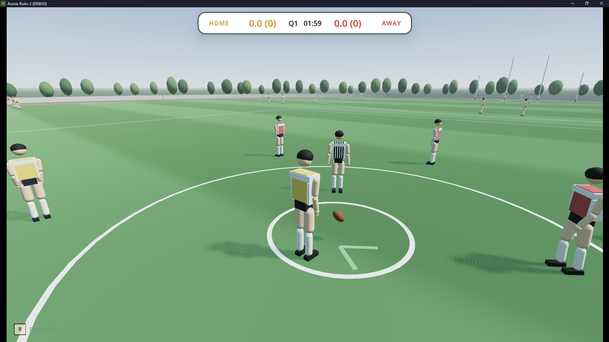

# Aussie Rules 2

A realistic 3D Aussie Rules football game built in **Godot 4.6**.

Contests are physically simulated — kicking, marking, tackling, spoiling, smothering and ruck contests emerge from player movement, timing, positioning and physics.


**Status:** a complete sided match — AI on every player you're not
controlling, real clock and quarters, physically resolved kicking,
handballing, bouncing, marking, tackling, spoiling, smothering, bumping,
and ruck contests, plus correct goal/behind restarts and a full-time score
screen. There's a menu system, a character screen, a team formation/tactics
editor, a settings/keyboard remapping screen, and a solo `Kick-to-Kick` practice mode
with three training coaches (kicking, marking, tackling). Every model,
animation, and sound effect is generated in code — there's no imported art
or audio yet.

See [docs/FEATURE_AUDIT.md](docs/FEATURE_AUDIT.md) for what's built vs.
still missing, [docs/HANDOVER.md](docs/HANDOVER.md) for the build history,
and [docs/RULES_REFERENCE.md](docs/RULES_REFERENCE.md) for how the real AFL
rules are simplified at this stage.


## Run

### Windows — Play the game

1. Go to the [latest release](https://github.com/Yaandle/aussie-rules2/releases).
2. Download **`Aussie-Rules-2-v0.1.0-Windows.zip`**.
3. Extract the ZIP.
4. Open the extracted folder.
5. Run **`Aussie Rules 2.exe`**.
6. Select **FULL GAME** from the main menu.

No Godot, Python, Git, or additional setup is required.

### Development — Godot

1. Install **Godot 4.6+**.
2. Clone the repository:

```powershell
git clone https://github.com/Yaandle/aussie-rules2.git
cd aussie-rules2
```

3. Open **Godot**.
4. Select **Import** and open the project's `project.godot` file.
5. In Godot, open the main game scene and use the **Play Project** button to run the game.
6. Select **FULL GAME** from the main menu.

### Development — PowerShell

Clone the repository:

```powershell
git clone https://github.com/Yaandle/aussie-rules2.git
cd aussie-rules2
```

Run the project using Godot:

```powershell
& "PATH_TO_GODOT\Godot_v4.6-stable_win64_console.exe" --path "PATH_TO_PROJECT"
```

For example:

```powershell
& "C:\Godot\Godot_v4.6-stable_win64_console.exe" --path "F:\dev\aussie-rules2"
```

Select **FULL GAME** from the main menu.

No Python installation or build step is required to run the Godot project.


## Project layout

```
project.godot            input map, autoloads, physics layers
scripts/
  tuning.gd               every tunable constant + shared enums (Team, Action)
  main.gd                 milestone-1 sandbox harness (scenes/main.tscn)
  autoload/                InputManager, GameState, ControlMode (routes human input to
                            whichever body should receive it — SINGLE_PLAYER/TEAM_COMMAND),
                            MatchState, CharacterProfile, Settings (persisted
                            user://settings.cfg), SceneWipe,
                            AudioManager (synthesized placeholder SFX)
  player/                  PlayerController (weight model, disposal, contests,
                            Slide/Lunge tackle resolution), PlayerAnimation,
                            HumanoidRig/HumanoidAnimations, KickTrajectory,
                            SkeletonWireframe
  mechanics/               PlayerBrain / HumanBrain / AIBrain / CommandBrain
                            (AIBrain + an issued-order override, TEAM_COMMAND's
                            non-selected teammates), CoachNPC, CoachChallenge
                            (shared base) + KickChallenge, MarkChallenge,
                            TackleChallenge
  modes/                   full_game.gd (match state machine), kick_to_kick.gd
  ball/                    Ball (RigidBody3D: spheroid hull, drag, Magnus, carry/launch)
  camera/                  BroadcastCamera (chase rig, Full-Side broadcast rig, dialogue two-shot)
  field/                   Field (oval markings, posts, fence, trees, score triggers)
  ai/                      TeamFormation (18-slot AFL formation data)
  ui/                      main menu, character screen, team list, settings,
                            remap screen, scoreboard, debug hud, pause/match-end screens
  dev/                     animation_viewer.gd — dev-only clip preview + a Tackle
                            Sandbox mode (two real, controllable players for testing
                            tackle/contest physics in isolation)

scenes/                   mirrors scripts/ — see each script's header comment
  modes/full_game.tscn     the match scene FULL GAME launches
  modes/kick_to_kick.tscn  solo practice, reached via the character screen
  dev/animation_viewer.tscn  not reachable from the menu — open directly in the
                              editor (see scripts/dev/ above)
  main.tscn                milestone-1 sandbox

assets/shaders/           turf, boundary glow, backdrop scrims — no imported art yet
docs/
  FEATURE_AUDIT.md         current-state inventory + development roadmap — start here
  HANDOVER.md              full session-by-session build log
  RULES_REFERENCE.md       Prototype 1's rule numbers translated to real metres
```

## Controls

| Action | Keyboard / Mouse | Pad |
|---|---|---|
| Move / walk / sprint | `WASD` / `Ctrl` / `Shift` | Stick / — / L3 (click) or RT |
| Camera / recentre | Mouse, arrows / `C` | Right stick / R3 |
| Kick stance — hold to aim/charge | Right Mouse (or `K`) | LT |
| Kick execute — aimed, while in stance | Left Mouse (or `F`) | RT (while LT held) |
| Kick hip-fire — quick, imprecise | Left Mouse (or `F`) | RT (LT not held) |
| Handball (toward move direction) | `Q` | X |
| Bounce (in possession) | `Space` | B |
| Slide tackle — hold, not carrying (higher takedown chance, real cost on a miss) | `E` | B |
| Lunge tackle — tap, not carrying (lower commitment, weaker against a fast carrier) | `Q` | X |
| Mark: Safe (hold) · Running (tap) · Aggressive (tap, jumps) | `G` · `Q` · `H` | A · X · Y |
| Spoil (not carrying, near a contest) | `P` | LT (tap) |
| Smother (not carrying, opponent mid-kick) | `Q` | X |
| Bump: hold stance, flick right stick to swing | `L` + flick | LB + flick |
| Hit-out — ruck contest only | `J` | RB |
| Switch controlled player (Single Player mode) | `Tab` | D-pad Left |
| Toggle Single Player / Team Command mode | `M` | D-pad Right |
| Issue a move-here order (Team Command mode) | `B` | Misc1 (Xbox Share / PS Create) |
| Pause | `Esc` | Start |
| Reset ball · Debug HUD | `R` · `F3` | Back · D-pad up |

### Gameplay notes

* **Slide / Lunge:** different tackle commitments; Slide is higher risk/reward, while Lunge is more conservative.
* **Team Command:** press `M` to toggle; control one player and issue movement orders to teammates.
* **Kick:** hold stance to aim and preview trajectory; tap execute for a quick hip-fire kick.
* **Context actions:** controls change depending on possession and situation.

### Training

`Kick-to-Kick` includes kicking, marking, and tackling coaches. Approach a coach and press `Q`/X to interact.

### Controls

Keyboard controls can be remapped through **Settings → Remap Controls**.

## Placeholder art

All characters, animations, and audio are currently procedurally generated. Character meshes use primitive geometry; imported art will be added later.



## Git Branch Guide

| Branch               | Purpose                                         | Stability |
| -------------------- | ----------------------------------------------- | --------- |
| **`dev`**            | Active development                              | May break |
| **`main`**           | Public / releasable game                        | Highest   |
| **`feature/...`**    | Larger isolated features                        | Temporary |
| **`fix/...`**        | Bug fixes                                       | Temporary |
| **`experiment/...`** | AI / gameplay experiments that may be abandoned | Temporary |

**Default branch:** `dev`

Development work should normally happen on `dev` or a temporary `feature/...`, `fix/...`, or `experiment/...` branch. Releases are made from `main`.
